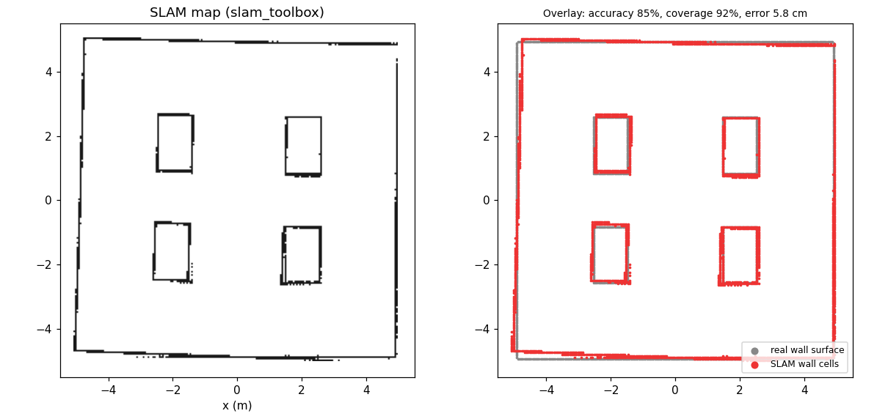

# Stage 3: Explore and build the map yourself (SLAM)

**Goal:** stop using the prebuilt map. Let the robot drive around and build its own map with
**SLAM**, then measure how good that map is.

## How to run it
**In the app:**
1. Mode **Mapping: Stage 3 (SLAM)** → **Start**. The grey map on the app grows as the robot sees walls.
2. Either drive around yourself (arrows / WASD), or press **S3: explore + save map**. The robot
   then drives a 37 m route on its own (~3.5 min) and saves the map.
3. **S3: compare maps** scores your map against the real one.
4. Later, in Stage 4: mode **Navigation on MY SLAM map** uses the map you just built.

**In a terminal:** `ros2 launch warehouse_runner stage3.launch.py explore:=true`

Files: `maps/slam.yaml` (SLAM settings), `scripts/explorer.py` (route driver),
`scripts/compare_maps.py` (map scoring), `launch/stage3.launch.py`.
Saved maps: Ubuntu `~/ros2_ws/maps/slam_map.yaml` + `.pgm` (a copy is in `docs/results/`).

---

## Theory 1: the chicken-and-egg problem
- To **build a map**, you need to know where the robot is (to place each laser scan correctly).
- To **know where the robot is**, you need a map (to compare the scan against).

**SLAM = Simultaneous Localization And Mapping** does both at once. It starts from the
odometry guess, then corrects it by matching each new scan against what it has already mapped.

## Theory 2: how slam_toolbox does it (graph SLAM)
1. **Odometry guess:** "I drove ~20 cm forward" (from `/odom`, which drifts).
2. **Scan matching:** slide the new scan around a little until it lines up best with the map
   so far. The best fit is the corrected pose.
3. **Pose graph:** every ~20 cm (`minimum_travel_distance`) a scan is stored as a node. The links
   between nodes say how far apart they are.
4. **Loop closure:** when the robot comes back to a place it has seen before, slam_toolbox
   recognises it and adds a link to that old node. Then the **Ceres solver** optimises the whole
   graph, which spreads out the drift that built up along the loop. This is why the explorer
   drives a full loop around the warehouse.
5. **Occupancy grid:** the corrected scans are drawn into a grid of 5 cm cells. Each cell is
   free (white), occupied (black) or unknown (grey). That's the `/map` topic.

## Theory 3: two new things in the TF tree
```
map  ──(slam_toolbox)──▶  odom  ──(Gazebo)──▶  base_footprint ─▶ base_link ─▶ base_scan
```
SLAM doesn't move the robot. It publishes the **correction** `map → odom`. Odometry stays smooth
but drifts, and `map → odom` keeps fixing the drift. In Stage 4, AMCL takes over this exact job
on a finished map.

## Theory 4: what a saved map is
`map_saver_cli` writes two files:
- `slam_map.pgm`: a greyscale picture of the grid (black = wall, white = free, grey = unknown)
- `slam_map.yaml`: `resolution` (0.05 m per pixel), `origin` (the world position of the
  bottom-left pixel), and the thresholds that turn grey values into free or occupied.
Nav2's `map_server` loads exactly these two files.

## Results (7 Nov 2026, headless Gazebo)
| Measure | Result |
|---|---|
| Exploration route | 10 waypoints, **37.0 m in 201 s**, no collisions |
| Map size | 10.05 × 10.05 m at 5 cm/cell |
| Wall coverage: real wall surfaces SLAM found (±10 cm) | **92 %** |
| Wall accuracy: SLAM wall cells on a real wall (±10 cm) | **85 %** |
| Mean wall position error | **5.8 cm** |
| Reachable floor marked free | **97 %** |
| Floor wrongly marked as wall | 2.9 % |



**Reading the result:** all 4 shelves and walls are there and within ~6 cm. The 15% of "wall
cells" that miss are mostly a doubled edge on a few walls. Small heading errors before a loop
closure smear a wall into two thin lines. The missing 8% of coverage are short wall pieces the
laser saw only at a grazing angle.

**A measuring lesson:** the first version of `compare_maps` reported only 60% coverage. It was
counting the *outside* faces of the warehouse walls, which no robot inside could ever see.
Restricting the score to surfaces reachable from HOME (a flood fill) gave the fair 92%. **Always
check that a metric measures what you think it measures.**

## Try it
- Drive the map yourself, badly (fast spins, no loop) and compare the score with the explorer's.
- In `maps/slam.yaml` set `do_loop_closing: false` and remap. Does the error grow?
- Watch `ros2 run tf2_ros tf2_echo map odom` while driving: that's the drift correction.

## Checklist
- [ ] I can explain why mapping and localization depend on each other
- [ ] I can explain scan matching and loop closure in one sentence each
- [ ] I know what `map → odom` means and who publishes it
- [ ] I know what the .pgm and .yaml files of a map contain

Next: **Stage 4**, Nav2 navigation (on the prebuilt map and on your own map).
