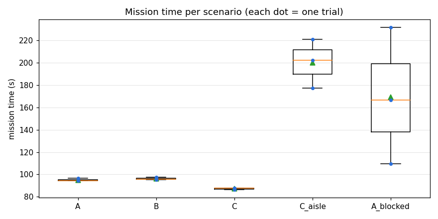
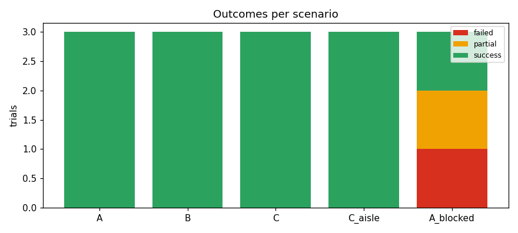

# Stage 7: Repeatable delivery trials (recording data, measuring success and performance)

**Goal:** stop judging the robot by one lucky run. Run the **same scenarios several times under
the same conditions**, record everything, and report numbers: success rate, time, distance,
recoveries, safety margin.

## How to run it
**App** (mode Navigation: Stage 4-7): **Run 5 trials**. That's each scenario once, ~15 min. Results go to
Ubuntu `~/ros2_ws/trials/<date-time>/`.

**Terminal** (more control):
```bash
ros2 launch warehouse_runner warehouse.launch.py gui:=false        # terminal 1
ros2 run warehouse_runner run_trials --repeats 3                   # terminal 2 (~45 min)
ros2 run warehouse_runner run_trials --only A,C_aisle --repeats 5 --bag   # subset + rosbags
ros2 run warehouse_runner analyze_trials                           # re-analyse the newest run
ros2 bag info ~/ros2_ws/trials/<run>/bags/01_A_1                   # what a bag contains
ros2 bag play ~/ros2_ws/trials/<run>/bags/01_A_1                   # replay it (e.g. into RViz)
```
Files: `scripts/run_trials.py`, `scripts/analyze_trials.py`.

## The scenarios
| Scenario | Order | Obstacles | Expected outcome |
|---|---|---|---|
| A, B, C | one station + HOME | none | success |
| C_aisle | C | wall across the centre aisle | success (with detour) |
| A_blocked | A | box on station A | **partial**: A fails safely, robot returns HOME |

Expected outcomes matter: for `A_blocked`, "partial" is the **correct** behaviour. The headline
metric is therefore **"behaved as expected"**, not just "succeeded".

---

## Theory 1: what makes an experiment repeatable
1. **Same start:** every trial begins at HOME, idle and localized. The runner sends the robot
   home if a trial ended elsewhere.
2. **Same world:** old boxes are removed and both costmaps cleared before each trial, so no
   memory of the last trial leaks in.
3. **Same settings:** the controller's settings are saved inside every mission report.
4. **Interleaved order:** A, B, C, C_aisle, A_blocked, A, B, … rather than A, A, A, B, B, B, so slow
   drift (e.g. a warming PC) doesn't bias one scenario.
5. **Automatic:** no human timing or judgement. The runner reads the controller's own reports.

## Theory 2: what is recorded
| Where | What |
|---|---|
| `trials.csv` | one row per trial: outcome, expected, time, distance, Nav2 recoveries, retries, min clearance, failed legs |
| `legs.csv` | one row per leg (station) |
| `missions/*.json` | the controller's full report for each trial |
| `bags/` (`--bag`) | **rosbag2** recording of `/odom /scan /plan /amcl_pose /cmd_vel /delivery/*`, so any trial can be replayed and inspected later |
| `summary.md/json`, `chart_*.png` | statistics and charts from `analyze_trials` |

## Theory 3: reading the numbers
- **Mean ± standard deviation:** the SD shows how *consistent* the robot is. Simulation is
  nearly deterministic, so a small SD is expected. Real robots vary much more.
- **Success rate with small n:** 3/3 isn't "100% reliable"; it means "no failures seen in 3
  tries". More repeats give more confidence.
- **Cost of a detour:** compare C vs C_aisle time and distance. That's the price of the blockage.
- **Cost of failing safely:** A_blocked's time is mostly retries. It's a tuning trade-off: fewer
  retries fail faster but give up more easily on temporary blockages.
- **Min clearance:** the closest the laser ever got to something. A safety indicator.

## Results: 15 trials (5 scenarios × 3), 35.3 min, 7 Nov 2026
Full data: [results/trials/](results/trials) (`trials.csv`, `legs.csv`, `summary.md`, charts).
Rosbags (105 MB, ~5 MB per trial) stay in Ubuntu `~/ros2_ws/trials/final-20261107-2259/bags/`.

**Behaved as expected: 13 / 15 (87%).**

| Scenario | Outcomes | As expected | Mission time (s) | Distance (m) | Nav2 recoveries | Min clearance (m) |
|---|---|---|---|---|---|---|
| A | 3 success | 100% | 95.0 ± 1.4 | 16.8 ± 0.3 | 0 | 0.61 |
| B | 3 success | 100% | 96.2 ± 1.1 | 16.9 ± 0.1 | 0 | 0.64 |
| C | 3 success | 100% | 87.3 ± 0.8 | 14.8 ± 0.0 | 0 | 1.06 |
| C_aisle (blocked) | 3 success | 100% | 200.2 ± 21.8 | 32.7 ± 2.5 | 2 ± 1 | 0.42 |
| A_blocked | 1 partial, 1 failed, 1 "success" | 33% | 169.3 ± 61.1 | 14.6 ± 3.5 | 28 ± 40 | 0.16 |

**Ground truth (Gazebo) vs. what the robot believed:**
| Scenario | True distance to goal when "reached" (worst leg) | AMCL error (worst leg) | False successes |
|---|---|---|---|
| A / B / C | 0.23–0.29 m | 0.09–0.18 m | 0 |
| C_aisle | 0.15 m | 0.11 m | 0 |
| A_blocked | 0.73 ± 0.52 m | **1.55 ± 1.28 m** | **1** |




**Reproduced (8 Nov 2026, app button "Run 5 trials", one of each):** A 97.1 s, B 96.3 s, C 88.1 s,
C_aisle 204.0 s (all success, all within the ranges above). A_blocked: **failed** again. Across
both runs, the blocked station was handled correctly in only 1 of 4 trials. That's the clearest
target for improvement.

## What the numbers say
1. **Normal deliveries are fast and very repeatable.** A, B and C: 9/9 successes, times within
   ±1.4 s (1.5%), no recoveries, never closer than 0.6 m to anything. In this clean world the
   navigation stack is essentially deterministic.
2. **A blocked aisle more than doubles the cost but never breaks the mission.** C_aisle: 3/3
   successes, but 2.3× the time (200 vs 87 s) and 2.2× the distance (32.7 vs 14.8 m). It also
   varies much more (±22 s), because *where* the robot first sees the wall decides how much it
   has to back-track. Clearance drops to 0.42 m: closer to things, still safe.
3. **An unreachable, unmapped goal is the weak spot.** Only 1 of 3 A_blocked trials ended the
   correct way (give up A, return HOME). The ground truth explains the other two:
   - *Trial 5, failed:* ~74 Nav2 recoveries (spins and back-ups) beside a large box that isn't
     in the map. AMCL's estimate drifted **2.7 m**. The robot was lost, so HOME also failed.
     The controller correctly reported **failed – needs help**.
   - *Trial 15, false success:* Nav2 reported A as *reached*, but the robot was really **1.1 m**
     away. AMCL was off by **1.7 m**. Without ground truth this would have been counted as a
     successful delivery.
   - Root cause: AMCL matches the laser against the map. A 1.2 m box that isn't in the map,
     seen close-up for minutes while spinning, pulls the particle filter towards wrong poses.
4. **Goal accuracy:** even on successful legs the robot stops 0.2–0.3 m from the true station.
   That's the 0.25 m goal tolerance plus ~0.1–0.2 m AMCL error. For pickup and docking you would
   need a tighter tolerance and a final precise approach.

## Finding the cause, and fixing it (8 Nov 2026)
**1. Diagnose from the rosbags.** Gazebo's `/odom` is exact here, so each bag gives "truth vs.
AMCL" over time. In the bad trials, AMCL was fine (≈0.1 m) while the robot stood ~1.2 m from A.
Then, **within 10–20 s of Nav2's spin recoveries**, its error jumped to 2.6–2.9 m. Spinning on
the spot beside a large *unmapped* box makes the laser view mostly "box", and AMCL matched it to
the wrong place in the map. In the one good trial, AMCL happened to survive the spins.

**2. Two ideas that did *not* work well enough** (checked offline on the bags first):
| Idea | Correct arrivals | The false success | Verdict |
|---|---|---|---|
| AMCL uncertainty (std) at arrival | 0.31–1.07 m (and 1.81 m at one *correct* HOME) | 1.57 m | overlaps, so it can't be a rule |
| Laser-vs-map agreement at arrival | 0.54–1.00 | 0.45 | margin too thin |

**3. The fix: don't let the struggle start.** In `delivery_controller.py`: when within 2.5 m
of the goal, if ≥ 15 laser hits lie within 0.65 m *of the goal itself* for 3 scans in a row, the
goal is occupied. Skip it at once: no retries, so no recovery spins next to the box. It uses only
the robot's own laser and AMCL pose. **Tested offline on all 15 bags before touching the robot:**
it fired in all 3 blocked trials (at 34–37 s, before the first spin at 37–39 s) and never in the
other 12. A first version with 5 hits would have fired once by mistake in a blocked-aisle trial
(13 hits near C during a brief AMCL error), so the threshold was raised to 15.

**4. Re-measured** ([results/trials-after-fix](results/trials-after-fix)):
| Blocked station A | Before (4 trials) | **After (6 + 1 trials)** |
|---|---|---|
| Handled correctly (partial: skip A, return HOME) | 1 / 4 | **7 / 7** |
| Mission time | 110–232 s | **74.7 ± 2.6 s** |
| Nav2 recoveries | 3–74 | **0** |
| Worst AMCL error | up to 3.6 m | **0.24 m** |
| False successes | 1 | **0** |

Regression (one of each scenario after the fix): A 96.4 s, B 98.7 s, C 89.0 s, C_aisle 195.5 s,
all success, **no false "blocked" alarms**. Overall: 11 / 11 behaved as expected.

**Honest limits of the fix:** the detection counts were 15–34 hits, so a few runs were right at the
15-hit threshold. A smaller box or a goal seen from far away could slip under it (then the old
retry logic still applies). It also only helps when the obstacle sits *on* the goal. A robot that
gets lost for other reasons still needs real "lost" detection.

## Next research steps
- **Re-localize when lost:** detect it (e.g. AMCL std rising fast during spins), then stop and use
  `/reinitialize_global_localization` + a slow spin.
- **Verify arrival** with something independent of AMCL, e.g. a marker at each station
  (fiducials / AprilTags on a real robot).
- **Gentler Nav2 recoveries near goals:** a custom behavior tree with fewer spins.
- **More repeats** for a rate estimate, e.g. `--only A_blocked --repeats 20`.

## Checklist
- [ ] I can list what keeps the trials comparable
- [ ] I know why "as expected" is a better metric than "success" here
- [ ] I can read mean ± SD and explain what a small n means
- [ ] I can replay a trial from its rosbag
